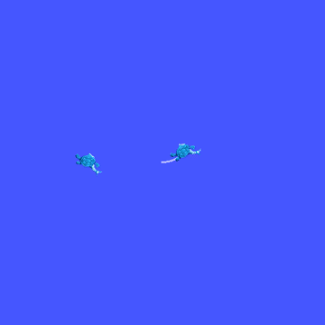
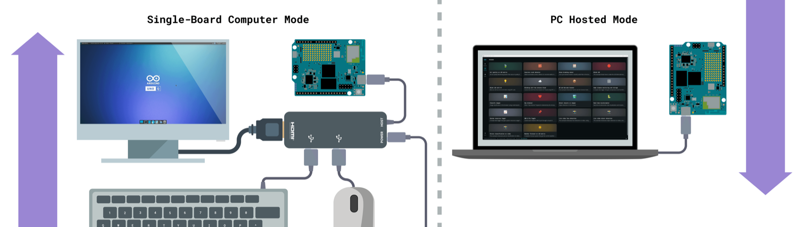
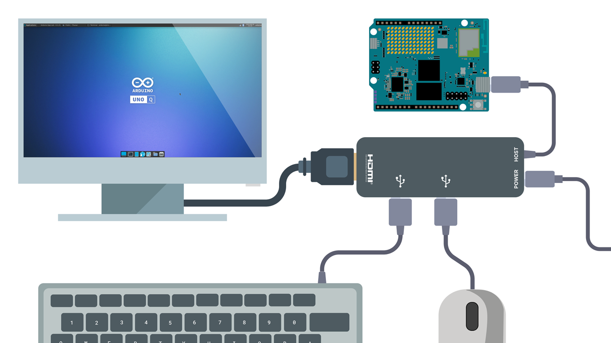

# Introduction

Run **ROS 2 Jazzy** in Docker on the **Arduino UNO Q** with one command. GUI apps such as turtlesim work on a monitor **or in your browser**.

```bash
curl -fsSL https://raw.githubusercontent.com/salmanfarisvp/unoq-ros2/main/install.sh | bash
```

{ width="360" }

## What is ROS 2?

**ROS 2** (Robot Operating System 2) is an open-source framework for building robot software. Programs called **nodes** exchange data over named channels called **topics**. That lets you build a robot from small parts, such as a sensor node, a planner node and a motor node.

We use **ROS 2 Jazzy Jalisco**, the current long-term support (LTS) release.

!!! info "Why Docker?"
    ROS 2 Jazzy is packaged for Ubuntu 24.04, but the UNO Q runs Debian. A Docker container gives ROS 2 the Ubuntu environment it needs and keeps the board's system clean. You can rebuild or remove it with one command.

## Two ways to use the UNO Q



| | Desktop mode (Single-Board Computer) | PC Hosted mode |
|---|---|---|
| Setup | Board + USB-C hub + monitor, keyboard, mouse | Board connected to your computer |
| You type commands in | A terminal on the board's desktop | Your computer, over SSH or ADB |
| GUI apps (turtlesim) open | On the monitor | In your browser at `http://<board-ip>:6080` |

Both modes run the same ROS 2 setup. The installer configures both.

## Requirements

### Hardware

- [Arduino UNO Q](https://store.arduino.cc/products/uno-q-4gb). The 4 GB RAM / 32 GB variant (ABX00173) is recommended.
- Wi-Fi or Ethernet with internet access.

**Desktop mode** also needs:

- A USB-C hub with its own power input, for example the [Arduino USB-C Hub](https://store.arduino.cc/products/usb-c-hub-8-in-1). Apple hubs don't work.
- A 5 V / 3 A power supply for the hub.
- An HDMI monitor, a USB keyboard and a mouse.

{ width="480" }

**PC Hosted mode** also needs:

- A computer on the same network as the board.
- A USB-C cable (for ADB or first-time setup).

### Software

- The latest UNO Q system image, with the first-time setup done in Arduino App Lab.
- A terminal on the board: the desktop terminal, SSH or ADB. See the [UNO Q User Manual](https://docs.arduino.cc/tutorials/uno-q/user-manual/).

## Start here

1. [Quick setup](quick-setup.md): install and test
2. [Pub/Sub Demo](pubsub.md): publish and subscribe from the shell
3. [Turtlesim modes](turtlesim.md): things to try, with GIFs

Prefer to set it up by hand? See [Manual setup](manual-setup.md).

<small>UNO Q images: © Arduino, from the [Arduino Docs](https://docs.arduino.cc/tutorials/uno-q/user-manual/), licensed [CC BY-SA 4.0](https://creativecommons.org/licenses/by-sa/4.0/).</small>
