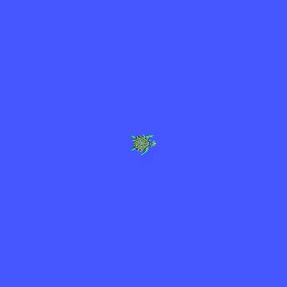
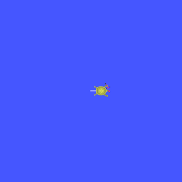
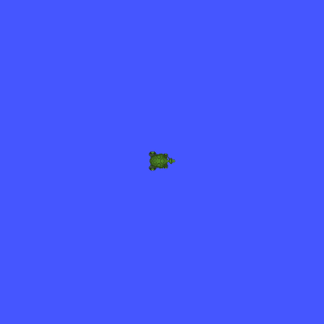
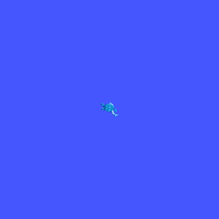
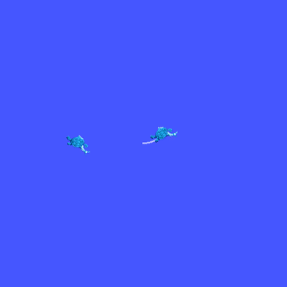
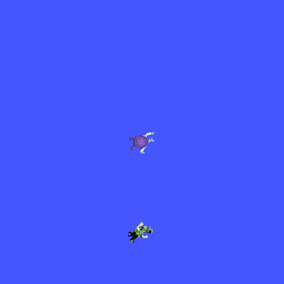
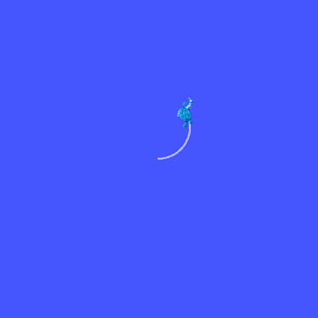

# Turtlesim modes

Start turtlesim in one container shell, then run each example in a **second** shell.

```bash
ros2 run turtlesim turtlesim_node
```

!!! note "No monitor?"
    Run `export DISPLAY=:99` before starting turtlesim, then watch at **http://&lt;board-ip&gt;:6080**.

Press ++ctrl+c++ to stop an example. Run `ros2 service call /reset std_srvs/srv/Empty {}` to start over.

## Circle

Publish a forward speed plus a turn rate.

```bash
ros2 topic pub --rate 1 /turtle1/cmd_vel geometry_msgs/msg/Twist \
  "{linear: {x: 2.0}, angular: {z: 1.8}}"
```

{ width="360" }

## Square

Built-in demo node.

```bash
ros2 run turtlesim draw_square
```

{ width="360" }

## Pen colour and width

Call a service to change the pen, then drive the turtle.

```bash
ros2 service call /turtle1/set_pen turtlesim/srv/SetPen \
  "{r: 255, g: 120, b: 0, width: 8, 'off': 0}"
```

{ width="360" }

## Teleport: draw a star

Jump the turtle to exact positions. It draws a line on each jump. Each call takes a few seconds on the board.

```bash
for p in "7.6 2.5" "2.0 6.8" "9.0 6.8" "3.4 2.5" "5.5 9.0"; do
  set -- $p
  ros2 service call /turtle1/teleport_absolute turtlesim/srv/TeleportAbsolute \
    "{x: $1, y: $2, theta: 0.0}"
done
```

{ width="360" }

## Two turtles

Spawn a second turtle and drive both.

```bash
ros2 service call /spawn turtlesim/srv/Spawn "{x: 3.0, y: 5.5, theta: 0.0, name: 'turtle2'}"

ros2 topic pub --rate 1 /turtle1/cmd_vel geometry_msgs/msg/Twist "{linear: {x: 2.0}, angular: {z: 1.8}}" &
ros2 topic pub --rate 1 /turtle2/cmd_vel geometry_msgs/msg/Twist "{linear: {x: 1.5}, angular: {z: -1.2}}"
```

{ width="360" }

## Mimic

`turtle2` copies every move of `turtle1`.

```bash
ros2 service call /spawn turtlesim/srv/Spawn "{x: 5.5, y: 2.0, theta: 0.0, name: 'turtle2'}"

ros2 run turtlesim mimic --ros-args \
  -r input/pose:=turtle1/pose -r output/cmd_vel:=turtle2/cmd_vel
```

Then drive `turtle1` from another shell (circle command above).

{ width="360" }

## Clear and reset

```bash
ros2 service call /clear std_srvs/srv/Empty {}   # erase the drawing
ros2 service call /reset std_srvs/srv/Empty {}   # back to the start
```

{ width="360" }

## Keyboard control

Drive the turtle with the arrow keys. This needs an interactive shell.

```bash
ros2 run turtlesim turtle_teleop_key
```
